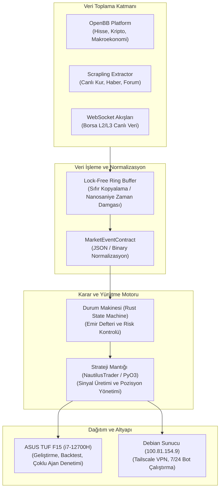

# Finansal Sistem Mimarisi ve Yapay Zeka Teknik Şartnamesi (AI Architecture Spec)

Bu doküman, sistem hafızasında ve çalışma ortamında yer alan finans, borsa, döviz ve algoritmik ticaret bileşenlerinin yapay zeka ajanları tarafından anlaşılması, genişletilmesi ve otomatik yürütülmesi için hazırlanmış teknik şartnamedir.

---

## 1. Sistem Bileşenleri ve Rolleri

### 1.1. OpenBB Platform (`OpenBB-finance/OpenBB`)
- **Rol:** Çoklu varlık (Multi-Asset) finansal veri toplama, normalizasyon ve analiz katmanı.
- **Entegrasyon Türü:** Python SDK ve REST API.
- **Kapsam:** Hisse senetleri (BIST, ABD), kripto varlıklar, makroekonomik göstergeler (FRED), opsiyonlar ve döviz kurları.
- **Kullanım Yeri:** Strateji öncesi veri keşfi, özellik mühendisliği (feature engineering) ve gösterge hesaplama.

### 1.2. NautilusTrader (`nautechsystems/nautilus_trader`)
- **Rol:** Ultra düşük gecikmeli, deterministik olay yönelimli (event-driven) yürütme ve backtesting motoru.
- **Çekirdek:** Rust (çekirdek yürütme, sıra tabanlı bellek yönetimi) + PyO3 / Cython (Python strateji arayüzü).
- **Kapsam:** Yüksek frekanslı emir defteri simülasyonu, canlı broker/borsa adaptörleri (Binance, Interactive Brokers vb.).
- **Kullanım Yeri:** Strateji doğrulama, simülasyon ve canlı emir tetikleme.

### 1.3. Event-Driven Rust Engine (`~/.jcode/skills/event-driven-rust-engine`)
- **Rol:** Yerel mikro olay motoru ve sıfır bellek tahsisatlı (zero-allocation) durum makinesi.
- **Çekirdek:** Rust `no_std` uyumlu bellek arenaları, lock-free ring buffer yapıları, `rkyv`/`bincode` serileştirme.
- **Kullanım Yeri:** Özel emir eşleştirme motoru (matching engine), risk yönetim kapıları ve sinyal filtreleme.

### 1.4. Scrapling (`D4Vinci/Scrapling` & `scrapling-markdown-extractor`)
- **Rol:** Anti-bot korumalı web kaynaklarından veri çekme motoru.
- **Özellikler:** Gerçekçi HTTP başlık taklidi (`Sec-Ch-Ua`, `Sec-Fetch-*`), Cloudflare koruması atlatma, LLM için optimize edilmiş Markdown dönüştürme.
- **Kullanım Yeri:** Resmi API sunmayan döviz/altın siteleri, borsa haberleri ve duyarlılık (sentiment) analizi.

---

## 2. Mimari Şema (Mermaid)



---

## 3. Olay Veri Sözleşmesi (Data Contract)

Olay döngüsünde (event loop) akan tüm piyasa girdileri aşağıdaki şemaya uymak zorundadır:

```json
{
  "$schema": "https://json-schema.org/draft/2020-12/schema",
  "title": "MarketEventContract",
  "type": "object",
  "required": ["instrument_id", "timestamp_ns", "event_type", "payload"],
  "properties": {
    "instrument_id": {
      "type": "string",
      "description": "Varlık çifti kodu, örn. USD-TRY, BTC-USDT"
    },
    "timestamp_ns": {
      "type": "integer",
      "description": "UNIX epoch nanosaniye hassasiyetli zaman damgası"
    },
    "event_type": {
      "type": "string",
      "enum": ["TICK", "ORDER_BOOK_L2", "NEWS_SENTIMENT", "SIGNAL"]
    },
    "payload": {
      "type": "object",
      "properties": {
        "bid": { "type": "number" },
        "ask": { "type": "number" },
        "volume": { "type": "number" },
        "signal_direction": { "type": "string", "enum": ["BUY", "SELL", "HOLD"] }
      }
    }
  }
}
```

---

## 4. Donanım ve Dağıtım Topolojisi

1. **Geliştirme ve Simülasyon Düğümü (Local Workstation):**
   - Donanım: Intel Core i7-12700H (14 çekirdek / 20 iş parçacığı), 16GB RAM.
   - İşlev: NautilusTrader ile paralel kene (tick) simülasyonları, geriye dönük testler (backtesting) ve hiperparametre optimizasyonu.
2. **Üretim ve Canlı Yürütme Düğümü (Headless Homelab Server):**
   - Donanım: Debian 13 (Trixie), Intel Atom mimarisi, Tailscale VPN erişimli (`100.81.154.9`).
   - İşlev: Düşük kaynak tüketimli canlı veri dinleme botu, limit emir tetikleme ve sistem sağlık izleme (Uptime Kuma).
